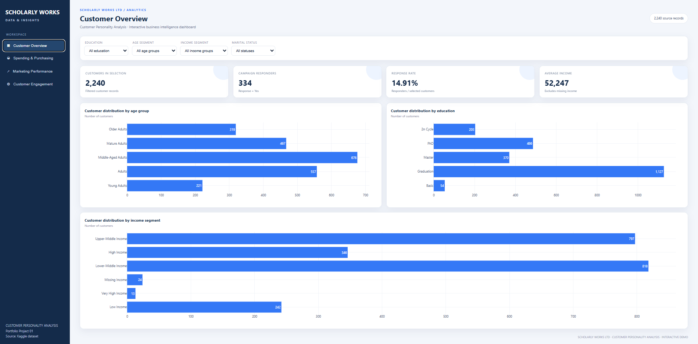
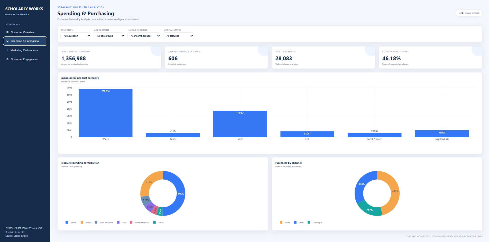
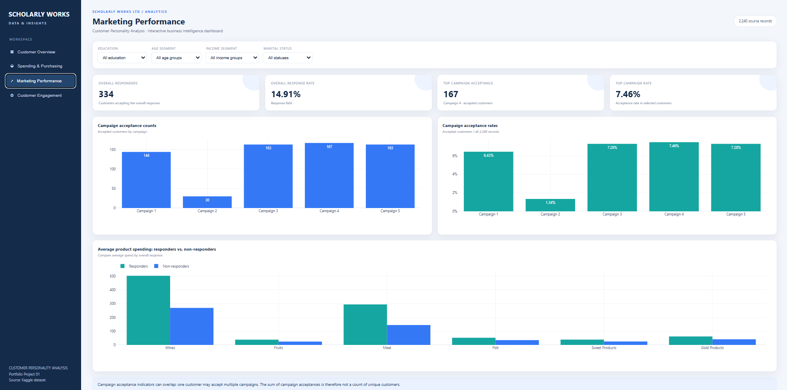
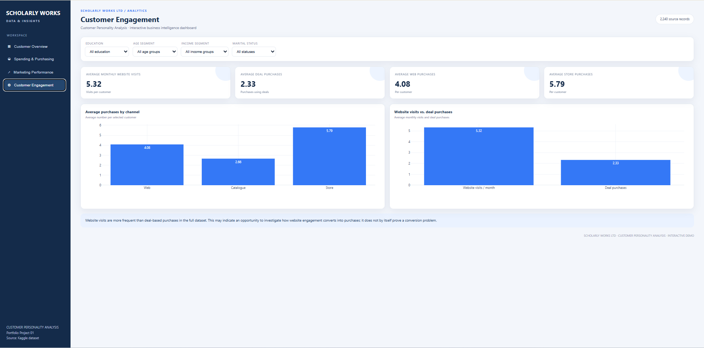

# Customer Personality Analysis

### Data Cleaning, Exploratory Data Analysis and Interactive Dashboard Development

**Developed by Scholarly Works Ltd**

---

## Project Overview

Customer Personality Analysis is a data analytics project focused on understanding customer demographics, purchasing behavior, spending patterns, and marketing campaign responses.

Using a real-world dataset obtained from Kaggle, this project demonstrates how raw customer data can be transformed into meaningful business insights through data cleaning, exploratory analysis, and interactive visualization.

The project examines 2,240 customer records and presents the findings through a custom-built, four-page interactive dashboard.

## Business Objectives

- Assess and improve customer data quality.
- Identify missing values, duplicates, unusual entries, and statistical outliers.
- Analyze customer demographics and income distribution.
- Examine spending patterns across product categories.
- Evaluate purchasing channels and customer engagement.
- Assess marketing campaign performance.
- Develop an interactive dashboard.
- Provide evidence-based business recommendations.

## Dataset Information

| Attribute | Description |
|---|---|
| Dataset | Customer Personality Analysis |
| Source | Kaggle |
| Original Records | 2,240 |
| Original Columns | 29 |
| Final Cleaned Columns | 27 |
| Missing Income Values | 24 |

**Dataset source:** [Customer Personality Analysis on Kaggle](https://www.kaggle.com/datasets/imakash3011/customer-personality-analysis)

## Tools and Technologies

- **Microsoft Excel:** Data cleaning, validation, calculations, and exploratory analysis.
- **Google Sheets:** Supporting data preparation and analysis.
- **HTML:** Dashboard structure.
- **CSS:** Dashboard styling and layout.
- **JavaScript:** Interactive functionality, filtering, and data processing.
- **Plotly.js:** Interactive charts and visualizations.
- **GitHub:** Project version control, documentation, and portfolio hosting.

## Data Cleaning and Preparation

The following procedures were performed:

1. Data inspection and profiling.
2. Missing-value assessment.
3. Duplicate customer ID and duplicate record checks.
4. Investigation of unusual demographic categories.
5. Statistical outlier detection using the Interquartile Range method.
6. Conversion of customer registration dates from text to valid dates.
7. Removal of two constant columns from the analytical dataset.
8. Preparation of a cleaned dataset containing 2,240 records and 27 columns.

The 24 missing income values were retained without imputation. Unusual values and statistical outliers were investigated and flagged rather than automatically deleted.

## Exploratory Data Analysis

The analysis covered:

- Customer age distribution.
- Customer income segmentation.
- Product spending patterns.
- Purchasing channel performance.
- Website engagement and deal-based purchases.
- Marketing campaign acceptance.
- Customer response patterns across demographic and behavioral groups.

## Key Findings

### Customer Demographics

- Middle-Aged Adults represented the largest age segment, with 676 customers.
- Lower-Middle Income was the largest income segment, with 818 customers.

### Product Spending

- Total recorded product spending was 1,356,988.
- Wines accounted for 50.17% of spending.
- Meat Products accounted for 27.56%.
- Together, Wines and Meat Products represented approximately 77.73% of total spending.

### Purchasing Channels

- Store purchases: 12,970.
- Web purchases: 9,150.
- Catalogue purchases: 5,963.

### Marketing Performance

- Overall campaign response rate: 14.91%.
- Campaign 4 recorded the highest acceptance rate at 7.46%.
- Campaign 2 recorded the lowest acceptance rate at 1.34%.
- A total of 334 customers responded to the overall campaign.

### Customer Engagement

- Average monthly website visits: 5.32 per customer.
- Average purchases using deals: 2.33 per customer.

## Interactive Dashboard

A custom-built interactive dashboard was developed using HTML, CSS, JavaScript, and Plotly.js.

The dashboard contains four pages:

1. **Customer Overview:** Customer demographics and key performance indicators.
2. **Spending and Purchasing Analysis:** Product spending and purchasing channel comparisons.
3. **Marketing Performance:** Campaign acceptance counts, rates, and customer response analysis.
4. **Customer Engagement:** Website activity and deal-based purchasing behavior.

The dashboard includes interactive filters that allow users to explore customer segments and analyze different aspects of the dataset.

### Dashboard Preview

#### 1. Customer Overview

#### 2. Spending and Purchasing Analysis

#### 3. Marketing Performance

#### 4. Customer Engagement

## Business Recommendations

- Improve marketing campaign targeting using observed customer response patterns.
- Investigate the low acceptance rate of Campaign 2.
- Maintain effective strategies for high-spending product categories.
- Improve conversion of website visits into purchases.
- Strengthen customer segmentation for more targeted marketing activities.
- Continue evaluating purchasing channel performance.

These recommendations are based on observed associations and should be validated through further business investigation.

## Project Files

The repository includes:

| File | Description |
|---|---|
| `Customer_Personality_Analysis.xlsx` | Analytical workbook containing raw data, working data, cleaned data, profiling, exploratory analysis, and cleaning summary. |
| `Scholarly_Works_Customer_Analytics_Dashboard.html` | Interactive four-page customer analytics dashboard. |
| `01_Customer_Overview.png` | Customer Overview dashboard screenshot. |
| `02_Spending_and_Purchasing.png` | Spending and Purchasing dashboard screenshot. |
| `03_Marketing_Performance.png` | Marketing Performance dashboard screenshot. |
| `04_Customer_Engagement.png` | Customer Engagement dashboard screenshot. |

**Note:** The dashboard uses Plotly.js from a content delivery network, so an internet connection is required to load its interactive charts.

## Conclusion

This project demonstrates the transformation of raw customer information into structured analytical data and meaningful business insights.

It showcases practical skills in data cleaning, data validation, exploratory data analysis, interactive dashboard development, data visualization, and business interpretation.

**Developed and documented by Scholarly Works Ltd.**

---

## Acknowledgement

Dataset provided by Kaggle. This project was independently developed by Scholarly Works Ltd for analytical learning and portfolio demonstration.
